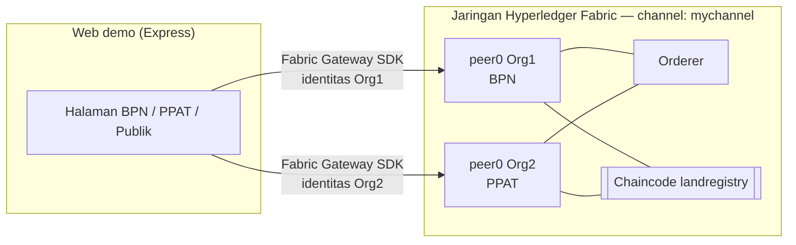

# Land Registry Fabric — Sertifikat Tanah di Blockchain

Prototype pencatatan **sertifikat tanah dan balik nama** berbasis **Hyperledger Fabric**, dengan studi kasus Indonesia.
Tujuannya menunjukkan bagaimana ledger bersama yang tidak bisa diubah sepihak dapat mencegah praktik mafia tanah:
**sertifikat ganda**, **penjualan tanah oleh orang yang bukan pemilik**, dan **perpindahan hak tanpa pengesahan BPN**.

## Latar Belakang

Indonesia sudah mulai menerapkan sertifikat tanah elektronik (Permen ATR/BPN No. 1/2021 dan No. 3/2023),
tetapi datanya masih tersimpan di sistem terpusat. Beberapa negara sudah memakai blockchain untuk pendaftaran tanah:

| Negara | Implementasi |
|---|---|
| Georgia | National Agency of Public Registry + Bitfury mencatat hak atas tanah di blockchain sejak 2016 |
| Dubai (UAE) | Dubai Land Department mencatat transaksi properti di blockchain sejak 2017 |
| Swedia | Lantmäteriet + ChromaWay menguji coba proses jual beli tanah di blockchain |
| India | Uji coba di beberapa negara bagian (mis. Andhra Pradesh) |

Prototype ini memodelkan konsep yang sama di atas Hyperledger Fabric, yaitu blockchain *permissioned*
yang cocok untuk lembaga pemerintah dan profesi yang identitasnya jelas.

## Arsitektur



| Organisasi Fabric | Peran | Hak di chaincode |
|---|---|---|
| `Org1MSP` | **BPN** (Badan Pertanahan Nasional) | Menerbitkan sertifikat, mengesahkan/menolak balik nama, memblokir |
| `Org2MSP` | **Notaris / PPAT** | Mengajukan balik nama berdasarkan Akta Jual Beli |
| — | **Publik** | Membaca status dan riwayat sertifikat |

Endorsement policy bawaan test-network membutuhkan **persetujuan peer kedua organisasi**,
sehingga tidak ada satu pihak pun yang bisa mengubah ledger sendirian.

## Aturan Bisnis di Chaincode

```
TerbitkanSertifikat (BPN) ──► AKTIF ──► AjukanBalikNama (PPAT) ──► PROSES_BALIK_NAMA
                                ▲                                       │
                                │        SahkanBalikNama (BPN) ◄────────┤ pemilik berganti
                                │        TolakBalikNama  (BPN) ◄────────┘
                                │
              BukaBlokir (BPN) ─┴─ DIBLOKIR ◄── BlokirSertifikat (BPN)
```

| Aturan | Mencegah |
|---|---|
| Satu NIB (Nomor Identifikasi Bidang) hanya boleh punya satu sertifikat | Sertifikat ganda |
| NIK penjual harus sama dengan pemilik tercatat saat ini | Menjual tanah milik orang lain / menjual dua kali |
| Hanya BPN yang boleh menerbitkan dan mengesahkan | PPAT atau pihak lain mengubah kepemilikan sendiri |
| Sertifikat `DIBLOKIR` atau sedang `PROSES_BALIK_NAMA` tidak bisa diajukan jual beli | Transaksi atas tanah sengketa / agunan |
| Semua perubahan tersimpan di riwayat ledger (`getHistoryForKey`) | Manipulasi jejak kepemilikan |

### Fungsi Chaincode

| Fungsi | Pemanggil | Keterangan |
|---|---|---|
| `InitLedger` | BPN | Mengisi 2 sertifikat contoh |
| `TerbitkanSertifikat(nomor, nib, lokasi, luasM2, nikPemilik, namaPemilik)` | BPN | Menerbitkan sertifikat baru |
| `AjukanBalikNama(nomor, nikPenjual, nikPembeli, namaPembeli, nomorAkta)` | PPAT | Mengajukan perpindahan hak |
| `SahkanBalikNama(nomor)` / `TolakBalikNama(nomor, alasan)` | BPN | Memutuskan pengajuan |
| `BlokirSertifikat(nomor, alasan)` / `BukaBlokir(nomor)` | BPN | Mengunci sertifikat sengketa |
| `BacaSertifikat(nomor)`, `CekBidangTanah(nib)`, `DaftarSertifikat()`, `RiwayatSertifikat(nomor)` | Semua | Query |

## Struktur Folder

```
land-registry-fabric/
├── chaincode/            # Smart contract (TypeScript, fabric-contract-api)
│   ├── src/landRegistry.ts
│   └── test/             # Unit test aturan bisnis (tanpa Docker)
├── application/          # REST API + web demo (Node.js, Fabric Gateway SDK)
│   ├── src/server.js
│   ├── src/fabric.js
│   └── public/           # Halaman web
└── scripts/              # Setup & menyalakan/mematikan jaringan
```

## Prasyarat (Windows)

1. **WSL2 dengan Ubuntu**: `wsl --install -d Ubuntu` di PowerShell (Administrator), lalu restart.
2. **Docker Desktop** dengan *Settings → Resources → WSL Integration* diaktifkan untuk Ubuntu.
3. Di dalam Ubuntu (WSL): `git`, `curl`, `jq`, dan **Node.js 18+**:
   ```bash
   sudo apt update && sudo apt install -y git curl jq
   curl -fsSL https://deb.nodesource.com/setup_20.x | sudo -E bash - && sudo apt install -y nodejs
   ```

> Semua perintah di bawah dijalankan **di terminal Ubuntu (WSL)**, bukan di PowerShell atau Git Bash.
> Folder Laragon bisa diakses dari WSL lewat `/mnt/c/laragon/www/land-registry-fabric`.

## Cara Menjalankan

```bash
cd /mnt/c/laragon/www/land-registry-fabric

# 1. Unduh fabric-samples + binary + image Docker (sekali saja, ±2 GB)
bash scripts/setup-fabric.sh

# 2. Nyalakan jaringan, buat channel, deploy chaincode
bash scripts/network-up.sh

# 3. Jalankan web demo
cd application
npm install
npm start
```

Buka **http://localhost:3000** di browser Windows.

Mematikan jaringan dan menghapus seluruh data ledger:

```bash
bash scripts/network-down.sh
```

Variabel lingkungan opsional: `TEST_NETWORK_PATH` (default `~/fabric-samples/test-network`),
`CHANNEL_NAME` (default `mychannel`), `CHAINCODE_NAME` (default `landregistry`), `PORT` (default `3000`),
`HOST` (default `0.0.0.0`), dan `BASE_PATH` (default `/`, mis. `/land-registry-fabric/` bila dipasang di subpath
di belakang reverse proxy).

### Deploy di VPS (subpath di belakang Nginx)

```bash
PORT=3100 HOST=127.0.0.1 BASE_PATH=/land-registry-fabric/ npm start
```

```nginx
location ^~ /land-registry-fabric {
    rewrite ^/land-registry-fabric/?(.*)$ /$1 break;
    proxy_pass http://127.0.0.1:3100;
    proxy_set_header Host $host;
}
```

`scripts/network-up.sh` mempublikasikan port peer dan orderer hanya di `127.0.0.1`,
karena port Docker tidak tersaring oleh UFW.

### Menjalankan Unit Test Chaincode (tanpa Fabric)

```bash
cd chaincode
npm install
npm run build
npm test
```

## Skenario Demo Presentasi (±5 menit)

1. **Tab BPN**: terbitkan sertifikat `SHM-3271-0003` atas nama **Budi Santoso** (form sudah terisi).
2. **Tab Notaris / PPAT**: ajukan balik nama ke **Sari Wulandari** dengan akta `AJB-001/2026`.
3. **Tab BPN**: klik **Sahkan** pada pengajuan. Pemilik berganti menjadi Sari.
4. **Tab Cek Sertifikat**: cek `SHM-3271-0003`. Riwayat lengkap tampil beserta ID transaksi.
5. **Tab Simulasi Mafia Tanah**: pilih `SHM-3271-0003`, lalu jalankan serangan:
   - *Sertifikat ganda* → ditolak: `SERTIFIKAT GANDA DITOLAK`
   - *Menjual tanah bukan miliknya* (NIK Budi) → ditolak: `NIK penjual bukan pemilik sah`
   - *PPAT mengesahkan sendiri* → ditolak: `AKSES DITOLAK`
   - Blokir sertifikat di tab BPN, lalu *jual tanah diblokir* → ditolak

Setiap penolakan dilakukan oleh **chaincode di peer**, bukan oleh tampilan web.
Hasilnya terlihat di panel **Log Transaksi**.

## REST API

| Method | Endpoint | Keterangan |
|---|---|---|
| GET | `/api/sertifikat` | Daftar semua sertifikat |
| GET | `/api/sertifikat/:nomor` | Detail sertifikat |
| GET | `/api/sertifikat/:nomor/riwayat` | Riwayat perubahan |
| GET | `/api/bidang/:nib` | Cari sertifikat berdasarkan NIB |
| POST | `/api/:peran/terbitkan` | Body: `nomor, nib, lokasi, luasM2, nikPemilik, namaPemilik` |
| POST | `/api/:peran/ajukan-balik-nama` | Body: `nomor, nikPenjual, nikPembeli, namaPembeli, nomorAkta` |
| POST | `/api/:peran/sahkan/:nomor` | Mengesahkan balik nama |
| POST | `/api/:peran/tolak/:nomor` | Body: `alasan` |
| POST | `/api/:peran/blokir/:nomor` | Body: `alasan` |
| POST | `/api/:peran/buka-blokir/:nomor` | Membuka blokir |

`:peran` adalah `bpn` (identitas Org1) atau `ppat` (identitas Org2). Transaksi dari peran yang salah
tetap dikirim ke jaringan dan akan **ditolak oleh chaincode**.

## Batasan Prototype

- Memakai `test-network` dari fabric-samples (1 peer per organisasi, 1 orderer). Belum siap produksi.
- Pemilik tanah tidak punya identitas di jaringan. Keabsahan penjual diverifikasi PPAT lewat NIK.
- Data pribadi (NIK) disimpan apa adanya demi kemudahan demo. Implementasi nyata sebaiknya memakai
  *private data collection* atau hash agar sesuai UU Pelindungan Data Pribadi.
- Belum ada peta bidang tanah, dokumen akta, maupun integrasi dengan sistem BPN.

## Lisensi

Apache-2.0
